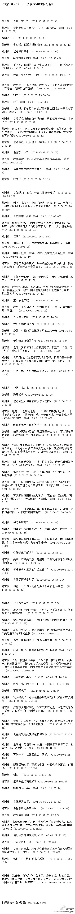
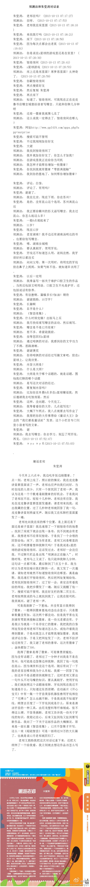

# 郑渊洁与魏若杨

> 记于 2026 年 10 月 13 日凌晨。

忘记在哪里看见或是想到了一个 Z，我突然想起小时候看皮皮鲁看到的“Z 星球”这个游戏，好奇他还在不在、还有没有人玩。这是我心里的一个遗憾，因为我小时候买的某一本书给了激活码（或者叫兑换码？），但我当时不懂事没有用，等到过期才发现有这么个东西。这个游戏我记得是必须用激活码才能注册的。

一查，似乎早已停止运营。我在郑渊洁与朱莹涛的聊天记录[^1]中看到了[该游戏的原网址](http://www.ppl419.com/apps.php)~~甚至用的还是 HTTP 协议~~，的确已经无法访问。奇怪的是，该网址是 Cloudflare 返回的“Sorry, you have been blocked”，令我有点疑惑。

不过，继续往下翻，我却翻到了[另一条有意思的微博](https://weibo.com/1977520435/zrVsYm8Rj)，是郑渊洁与魏若杨的聊天记录，具体如下：

我看到末尾时，突然产生一种搜索魏若杨现状的冲动——他究竟有没有称为国家领导人？郑渊洁是否又还真能记住他呢？~~我觉得不太能罢~~

遂进行搜索。在必应上搜出来的都是网络小说，使我略感疑惑。用微信搜索，如果不是重名的话，这位魏若杨似乎是中央民族大学附属中学 2015 **届**（即 2012 **级**）的高中文科毕业生，高考成绩优秀（672 分）[^2]，该信息与“2011 年 14 岁住在北京”完全吻合。

同年，他的名字和照片出现在[《上理颜值大爆料 第二期！女版》](https://mp.weixin.qq.com/s/MvVdowEeATlvwWpGwTzZWw)一文中，据此推测他毕业进入了上海理工大学管理学院。根据其自我（大约是？）介绍，他是“一个新疆姑娘”。

情况在这里发生了变化。在 2016 年的[《以我所学，回报社会│新一届管理层介绍》](https://mp.weixin.qq.com/s/W-3aeTiPAecuqrR33ocAow)中，魏若杨作为中国人民大学法律援助中心的副部长出现，其介绍为 2015 级法学本科，照片显示为男性。2017 年的[《JT&N荣誉|北京律协评选优秀所刊、微信公众号，金诚同达获奖》](https://mp.weixin.qq.com/s/4e13lv0ZxCJ7PAqOE0FqBw)中照片左一推测为同一人。同时，我注意到必应搜索结果中有一个[名为“魏若杨”的知乎账号](https://www.zhihu.com/people/wei-ruo-yang-26/collections)，其个性签名为

> 多恶意的所谓揣测和所谓中伤赶不上一句“情节轻微，不予起诉。”

其 2015 年的收藏夹“法律”下标注“律师”。他在 2016 年[提问：“蜀汉后期政权的变化和情况究竟如何？”](https://www.zhihu.com/question/49440162)，可见这位魏若杨对历史比较感兴趣，符合之前与郑渊洁的对话，我推测这位才是我们要找的魏若杨。综合其他微信搜索结果，他应该在本科时就与金诚同达有联系，后来多次为金诚同达写书、写文章，主题包括劳动争议、工伤等，因此推测其主要方向为《劳动法》及相关法律。

值得注意的是，2019 年后再看见这个名字，就是[《青年榜样 | 招商华软华婉欣荣获国资委2021-2022年度“优秀共青团员”称号》](https://mp.weixin.qq.com/s/ZZrqT8ZHZzy1hIjTFFqY_w)。图片中，魏若杨已经是国资委机械机关服务中心的九级职员了，并且获得了 2021-2022 年的优秀共青团员。按照年龄，我们要找的魏若杨现在应该 25 岁，尚未到达自动退团年龄，且这位性别也是男性，所以这可能是我们要找的那一位。最新的一条消息则是[《团青动态 | 国务院国资委管理局举办“青春永向党 书香伴成长”青年主题活动》](https://mp.weixin.qq.com/s/vUKnNL6AAP0lZfokhQJyRA)，国资委机械机关服务中心的魏若杨作为优秀青年代表进行了发言，看起来一把年纪了。图片模糊看不清楚，但看起来和 2016 年的人大法律援助中心的副部长比较像，我有大于一半的把握觉得他们是同一个人。

我也是够闲的，明明都忙不过来了。

[^1]: 原链接是 [微博](https://weibo.com/1977520435/AhKSt3dJm)。不过为了防止丢失，我在此保存原图如下：

[^2]: [2015届高考成绩通报](https://mp.weixin.qq.com/s/YyeO1cI94uKfImyXMa-rDw)。该文作者“和字碑下”是中央民族大学附属中学认证账号，由该学校团委学生会运营。
